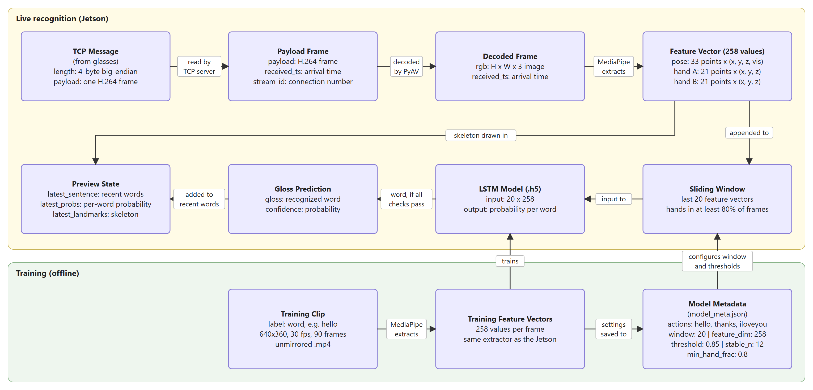

# 2. Implementation Details

## 2.1 Technology Stack

| Layer | Technology | Why this over the alternative |
| --- | --- | --- |
| **Frontend** | Browser preview served by the Jetson (Python MJPEG stream with an OpenCV overlay) | Opens in any browser on the local network with no install or build step. A React app would add a second toolchain for a demo view. |
| **Backend** | Python 3.10 on the Jetson (PyAV, MediaPipe, TensorFlow/Keras LSTM). C firmware on the ESP32-P4 (ESP-IDF 5.4.4) | Training and the Jetson share one Python feature extractor. ESP-IDF supports the P4's hardware H.264 encoder, which uses far less bandwidth than JPEG. |
| **Database** | None. Data is stored in files: video clips with `manifest.csv`, a Keras `.h5` model and `model_meta.json` | No user records or queries, so a database server would add work with no benefit. The metadata is versioned in Git with the model. |
| **Deployment** | Docker container on a Jetson Orin Nano Super (JetPack 6). Firmware flashed with `idf.py flash` | Fully local and offline, with no cloud cost. The container pins the fragile TensorFlow and MediaPipe versions. |
| **CI/CD** | GitHub Actions: clang-format lint, ESP32 firmware build, Python unit tests | Free and built into our GitHub repo. It checks the build and the streaming logic on every push without hardware. |

**Table 2:** Technology choices.

## 2.2 Data Model

NARM has no database, so this figure shows the system's **data model**: every piece of data the system creates, from the training clips to a recognized word, and how each one is turned into the next. Field names come from the source code (`tcp_ingest_server.py`, `main.py`, `asl_features.py`, `holistic_lstm_infer.py`, `models/model_meta.json`).

<!-- Source: figure2_data_model.html (open in a browser to view or edit) -->

**Figure 2:** NARM data model. Each box is a piece of data the system creates, with its main fields. Each labelled arrow shows how one piece of data is turned into or used by the next: the top section shows video from the glasses becoming a recognized word, and the bottom section shows training clips becoming the model and settings the live side uses.

## 2.3 Key Implementations

### Key Implementation A: Streaming 1080p H.264 from the glasses to the Jetson without losing frames

**Problem:** The ESP32-P4 sends video through its ESP32-C6 coprocessor over 2.4 GHz Wi-Fi, so bandwidth is tight, and the Jetson can't always keep up with the camera. H.264 keeps the stream small, but each frame depends on earlier ones, so dropping a single compressed frame corrupts the video. **How it works:** The P4's hardware encoder compresses each camera frame, and a sender task writes it over TCP as `[4-byte length][H.264 frame]`. On the Jetson, `TCPIngestServer` reads each frame back out of the stream and tags it with a connection ID. Compressed frames go into a blocking queue, so when the Jetson falls behind, TCP backpressure slows the sender instead of throwing away frames, and the decoder resets on every reconnect. CI tests check slow-receiver, reconnect and button stop/restart behaviour without hardware.

### Key Implementation B: Real-time sign recognition with matching training and live features

**Problem:** A model that scores well in training fails live if the live features differ even slightly from the training ones, for example a mirrored frame or swapped hands. A raw per-frame prediction also flickers between words and fires when no one is signing. **How it works:** Training and the Jetson use the same `asl_features.py`, which turns each unmirrored 640×360 frame into a fixed 258-value vector of MediaPipe pose and hand landmarks. Only the two newest decoded frames are kept, so inference stays current. A 20-frame sliding window feeds the LSTM, and a word is reported only when hands appear in at least 80% of the window, the last 12 predictions agree, confidence is at least 0.85, and the word differs from the last one reported. All of these values come from `model_meta.json`, so the live settings always match the trained model.
